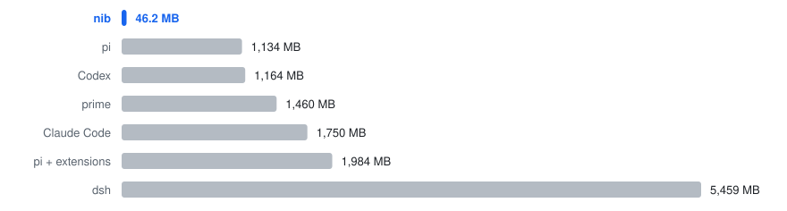

<p align="center">
  <picture>
    <source media="(prefers-color-scheme: dark)" srcset="docs/assets/logo-dark.svg">
    
  </picture>
</p>

<h1 align="center">nib</h1>

<p align="center">English | <a href="README.zh-CN.md">中文</a></p>

A small, focused, quiet coding agent.

nib works in Runs: the model writes one JavaScript script that reads, edits and checks your project in a single step.

## Numbers

Against Codex CLI on the same model:

**12% faster · 44% cheaper · 32% fewer requests · 20/20 passed**

<picture>
  <source media="(prefers-color-scheme: dark)" srcset="docs/assets/bench-versus-dark.svg">
  
</picture>

**Ten agents open:**

<picture>
  <source media="(prefers-color-scheme: dark)" srcset="docs/assets/bench-memory-dark.svg">
  
</picture>

6 MB static binary · no runtime dependencies.

*Nov 2026 · gpt-6.1-terra, medium · 20 runs vs Codex CLI 0.166.0 at API prices · memory of idle TUIs.*

[More numbers →](docs/benchmarks.md)

## Install

Linux (x86_64, arm64) and macOS (Apple silicon):

```sh
curl -fsSL https://raw.githubusercontent.com/yyydddkkk/nib-code/main/install.sh | sh
```

Installs to `~/.local/bin`. `nib update` upgrades in place. `NIB_VERSION` pins a release, `NIB_INSTALL_DIR` changes the directory.

From source (Zig 0.17): `zig build -Doptimize=ReleaseFast --prefix ~/.local`

For daily development without replacing stable `nib`, [install `nib-dev` from local `dev`](docs/developing.md).

## Use

`/simple` or Ctrl+S hides everything but the conversation.

Optional sandboxed `after_edit` and `turn_end` commands: [hooks](docs/config.md#hooks).

```sh
cd your-project
nib                          # interactive
nib ask 'explain the entry points'
nib -c                       # continue the last session here
```

Run `nib`, then `/provider` to sign in; `/model` picks a model. Codex, Claude, OpenAI, DeepSeek, Grok or [your own endpoint](docs/providers.md).

Enter sends, Shift+Enter adds a line, Esc cancels. Type `/` for commands: `/provider`, `/model`, `/effort`, `/undo`, `/tasks`, `/skills`, `/status`. `@` completes file paths.

`/mcp` turns on MCP servers from config.toml. [Plugins](docs/plugins.md) bundle skills, commands and MCP servers: `nib plugin install <path-or-git-url>`, then `/plugins on <name>`. Installed plugins are off by default.

Project conventions go in `AGENTS.md`; personal ones in `~/.nib/AGENTS.md`.

## A Run

```text
  Run · edit 2 files · bash
    src/grep.zig +38 −9 · src/tools.zig +2 −1
    read src/grep.zig · read src/tools.zig · grep src
    └─ b1 bash zig build test · 1s · completed ✓ exit 0

  1 Run · 2 steps · 41s · 6.6k tokens
```

One block per script: what changed, what was read, what ran. Click a Run to see its diff, result and script; Ctrl+O opens the latest.

## Safety

nib runs model-written code with your permissions, like you would. bash refuses obviously destructive commands; `[sandbox] mode = "workspace"` limits writes to the project, temp dirs and build caches (Landlock on Linux, sandbox-exec on macOS). Commit before you start. Sessions are logged locally in `~/.nib/sessions` (mode 0600). Full tool arguments/results are not recorded by default; set `NIB_RECORD=on` to enable [offline replay](docs/replay.md).

## More

[Principles](docs/principles.md) · [Docs](docs/README.md) · [Providers](docs/providers.md) · [Config](docs/config.md) · [Releases](docs/releases/) · [MIT](LICENSE)
