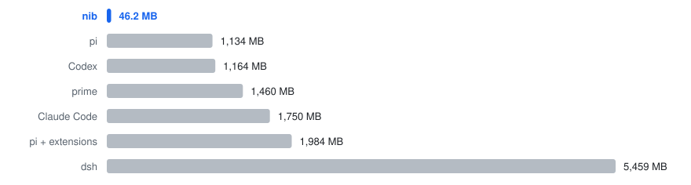

<p align="center">
  <picture>
    <source media="(prefers-color-scheme: dark)" srcset="docs/assets/logo-dark.svg">
    
  </picture>
</p>

<h1 align="center">nib</h1>

<p align="center"><a href="README.md">English</a> | 中文</p>

专注 coding 的小而美 agent，安静地和你一起写代码。

nib 以 Run 为工作单位：模型写一段 JavaScript，一步完成读取、修改和验证。

## 数据

与 Codex CLI 使用同一模型：

**快 12% · 费用低 44% · 请求少 32% · 20/20 通过**

<picture>
  <source media="(prefers-color-scheme: dark)" srcset="docs/assets/bench-versus-dark.svg">
  
</picture>

**同时打开十个 agent：**

<picture>
  <source media="(prefers-color-scheme: dark)" srcset="docs/assets/bench-memory-dark.svg">
  
</picture>

**nib 0.19.0**：Linux x86-64 静态二进制 6.7 MB · 单实例空闲 RSS 4.6 MB · 无运行时依赖。内存图仅更新 nib 的实测值，其他 agent 沿用历史数据。

*任务基准：2026 年 11 月 · gpt-6.1-terra、medium · 对比 Codex CLI 0.166.0 共 20 次运行，按 API 价格计费。*

**通用提示词为 1,493 tokens**，含通用工具说明。[各模型家族的完整请求开销 →](docs/benchmarks.md#current-prompt-footprint)

## 安装

支持 Linux（x86_64、arm64）和 macOS（Apple 芯片）：

```sh
curl -fsSL https://raw.githubusercontent.com/yyydddkkk/nib-code/main/install.sh | sh
```

安装到 `~/.local/bin`，`nib update` 原地升级。`NIB_VERSION` 指定版本，`NIB_INSTALL_DIR` 更换目录。

从源码构建（Zig 0.17）：`zig build -Doptimize=ReleaseFast --prefix ~/.local`

## 使用

`/simple` 或 Ctrl+S 只留下对话。

可选的沙箱内 `after_edit` 和 `turn_end` 命令：[hooks 配置](docs/config.md#hooks)。

```sh
cd your-project
nib                          # 交互界面
nib ask '讲讲这个项目的入口'
nib -c                       # 继续本目录上次的会话
```

运行 `nib`，用 `/provider` 登录；`/model` 选模型。支持 Codex、Claude、OpenAI、DeepSeek、Grok 或[自己的站点](docs/providers.md)。

Enter 发送，Shift+Enter 换行，Esc 取消。输入 `/` 查看指令：`/provider`、`/model`、`/effort`、`/undo`、`/tasks`、`/skills`、`/status`。`@` 补全文件路径。

`/mcp` 启用 config.toml 中配置的 MCP 服务器。

项目约定写在 `AGENTS.md`，个人习惯写在 `~/.nib/AGENTS.md`。

## 一个 Run

```text
  Run · edit 2 files · bash
    src/grep.zig +38 −9 · src/tools.zig +2 −1
    read src/grep.zig · read src/tools.zig · grep src
    └─ b1 bash zig build test · 1s · completed ✓ exit 0

  1 Run · 2 steps · 41s · 6.6k tokens
```

每个脚本一个块：改了什么、读了什么、跑了什么。点击某个 Run 查看 diff、结果和脚本；Ctrl+O 打开最近一个。

## 安全

nib 像你自己一样，以你的权限运行模型写的代码。bash 拒绝明显危险的命令；`[sandbox] mode = "workspace"` 将写入限制在项目、临时目录和构建缓存中（Linux 用 Landlock，macOS 用 sandbox-exec）。开始前先提交。会话日志保存在本机 `~/.nib/sessions`（权限 0600）。默认不全文录制工具参数与返回值；设置 `NIB_RECORD=on` 可开启[离线 replay](docs/replay.md)。

## 更多

[原则](docs/principles.md) · [文档](docs/README.md) · [Provider](docs/providers.md) · [配置](docs/config.md) · [版本说明](docs/releases/) · [MIT](LICENSE)
