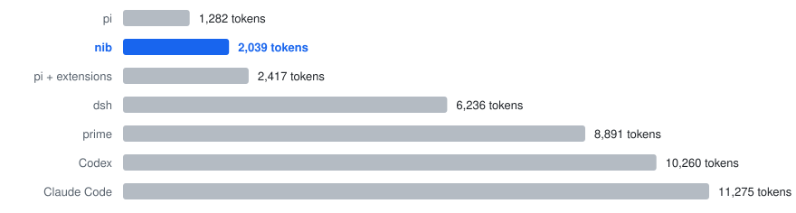

# Data

## Current nib resource usage

| Release | Installed size | Idle RSS | Total RSS of 10 idle instances |
| --- | ---: | ---: | ---: |
| nib 0.19.0 (Linux x86-64, static) | 6.7 MB | 4.6 MB | 46.2 MB |

The installed size is for the extracted, stripped binary from the checksum-verified release archive. Idle RSS is the median of five trials with clean, signed-out TUIs in 140×40 PTYs, with no model requests. The ten-instance measurement sums each trial's RSS from Linux `/proc/<pid>/smaps_rollup`; shared resident pages can be counted in more than one process. Values use decimal MB. The README memory chart uses this nib measurement and retains the historical values for the other agents below.

## Current prompt footprint

The **shared prompt in nib 0.19.0 is 1,493 tokens**. It includes the common system instructions and JavaScript tool API, but not selected strategy variants, patches, endpoint-only tool text, or outer request-tool definitions. It is a measure of shared text, not a request total.

| Example | Family → Profile | System | Request tool definitions | Total fixed input |
| --- | --- | ---: | ---: | ---: |
| Codex / GPT-6.2 Sol | GPT → `codex` | 1,827 | 212 | 2,039 |
| Anthropic / Claude Sonnet 5.5 | Claude → `claude` | 1,784 | 201 | 1,985 |
| DeepSeek / DeepSeek Flash | DeepSeek → `deepseek` | 1,804 | 203 | 2,007 |
| Custom Chat Completions / Gemini fixture | Gemini → `default` | 1,687 | 203 | 1,890 |
| Custom Chat Completions / unknown-model fixture | Unknown → `default` | 1,679 | 203 | 1,882 |

These are offline `o200k_base` estimates (not billed usage). The fixtures use cwd `/work`, default limits, no project or global instructions, no history, and no enabled extensions. The tool definitions are taken from the actual protocol encoders. The two custom fixtures exercise routing without implying native service support. The chart below shows nib’s shared-only count alongside the other agents’ historical full counts. The chart does not compare full request overhead on an equal basis.

```sh
zig build prompt-footprint | uv run --no-project --with tiktoken==0.14.0 python scripts/prompt_footprint.py
```

## Historical resource usage

| Agent | Version | Installed size | Idle RSS | Total RSS of 10 idle instances | Fixed prompt per request, ≈tokens |
| --- | --- | ---: | ---: | ---: | ---: |
| nib | 0.9.0 (release, static) | 6 MB | 4.8 MB | 47 MB | 2.3k |
| pi (clean) | 1.4.0 | 108 MB + Node (121 MB) | 124 MB | 1,134 MB | 1.3k |
| pi (everyday extensions) | 1.4.0 | 620 MB + Node | 358 MB | 1,984 MB | 2.4k |
| Codex CLI | 0.166.0 | 305 MB | 275 MB | 1,164 MB | 10.3k |
| Claude Code | 2.1.319 | 324 MB | 174 MB | 1,750 MB | 11.3k |
| prime-agent | 0.10.2 | 63 MB + Python worker | 335 MB | 1,460 MB | 8.9k |
| dsh | dst TUI 0.16.1 | 141 MB + Node | 544 MB | 5,459 MB | 6.2k |

*Measured locally in November 2026, idle TUI in a 140×40 terminal, no model requests; fixed prompts include system and tool definitions. nib re-measured at 0.9.0 under the same conditions (0.5.0 reproduces 3.8 MB / 38 MB there).*

## Prompt sizes as reported

<picture>
  <source media="(prefers-color-scheme: dark)" srcset="assets/bench-prompt-dark.svg">
  
</picture>

*nib 0.19.0 shows only its shared prompt and common tool API, excluding model profiles and request tool definitions. Other agents retain their November 2026 full fixed-prompt counts.*

## Comparison with Codex CLI

| Metric | nib | Codex CLI | Difference |
| --- | ---: | ---: | ---: |
| Wall time (median) | 128 s | 144 s | 12% faster |
| Cost per task (API prices) | $0.044 | $0.079 | 44% lower |
| Model requests (median) | 13 | 19 | 32% fewer |
| Input tokens per task | 192k | 623k | 69% fewer |
| Tasks passed | 20/20 | 20/20 | — |

*November 2026, gpt-6.1-terra, medium, 4 tasks run 5 times each; nib build from the 0.4 period, codex-cli 0.166.0.*

### Cost per task

| Task | nib | Codex CLI |
| --- | ---: | ---: |
| timers | $0.052 | $0.109 |
| bash-amp | $0.029 | $0.062 |
| grep-column | $0.038 | $0.054 |
| console-tail | $0.059 | $0.090 |

<picture>
  <source media="(prefers-color-scheme: dark)" srcset="assets/bench-cost-dark.svg">
  
</picture>

*Same comparison runs, USD at API prices; each task uses an average close to the median.*

## How measured

- Same model, gpt-6.1-terra, medium effort; 4 tasks run 5 times each, 20 runs total.
- Record wall time, API cost, model requests, input tokens, and tasks passed.
- Measure installed size and idle RSS locally; measure total RSS of 10 instances separately.
- Fixed prompts count system and tool definitions carried by each request.
- Source: [benchmarks/data.json](benchmarks/data.json); run `python3 scripts/charts.py` to regenerate eight light/dark SVGs.
