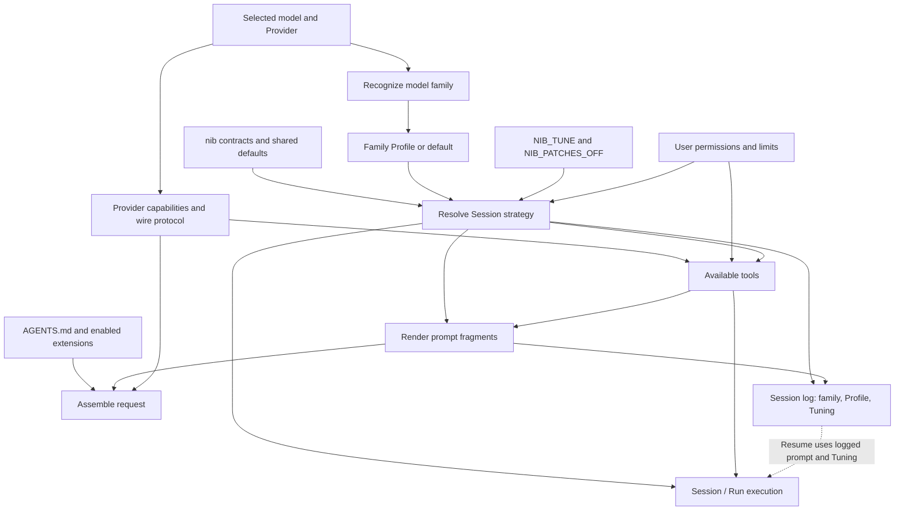

# Model Profiles

A Model Profile is a set of strategy overrides for a **model family**, not a user configuration file, a Provider, or a second system template. See [ADR 0025](adr/0025-model-profiles.md) and [ADR 0026](adr/0026-tuning.md).

| Family | Profile log label | Default variation |
| --- | --- | --- |
| GPT | `codex` (existing label) | Shared defaults |
| Claude | `claude` | Shared defaults |
| DeepSeek | `deepseek` | `delivery=tool`, `validation=none` |
| Gemini | `default` | Shared defaults |
| Unrecognized | `default` | Shared defaults |

Family detection uses the model name, not the Provider or API shape. Family routing never substitutes a different model or grants an unsupported capability. Recognizing Gemini does not add a native Gemini Provider. A new model in an existing family follows that family's Profile; unrecognized model names fall back without a warning.

## Ownership

- **nib** owns tool contracts, sandboxing, cancellation, logging, and delivery guarantees. User permissions and explicit limits do not become Profile settings.
- **Provider** owns capabilities and wire encoding. It does not look up Model Profiles.
- **Profile** selects strategy variants. Session, tool exposure, and prompt rendering read the same choice. For example, a normal child Session can fold results into tool output but cannot use `tools.wait()`; when idle it replies without tools and waits locally.
- **Prompt patches** remain independently removable by ID and can be scoped to Profiles. Do not duplicate a patch's instruction in the common template. Use a Tuning when a variation changes execution as well as text.

The boundary for strategies is movable: promote a family strategy when it works as a shared default, move a common strategy into a Profile when evidence shows that only some families benefit, and remove workarounds without a measurable effect. Keep the execution contracts independent of those moves.

## Session lifecycle

New Sessions resolve once. Resumed Sessions retain the exact logged system prompt and restore logged Tuning; changing the current defaults or experiment switches does not rewrite them. Forks still inherit their parent's system text and resolve the child's runtime Tuning; that can differ when the allowed model change crosses families or experiment settings change. This is not a promise that forks are re-rendered for the child model.

See [prompt footprint](benchmarks.md#current-prompt-footprint) for the distinction between shared fragments and the full fixed request input.
